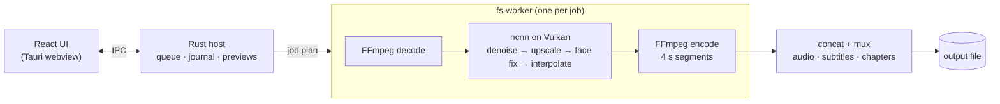

<div align="center">


# FrameScale AI

**AI video upscaling, denoising, face restoration and frame interpolation,
on your own GPU.**

[](LICENSE)


[Features](#features) ·
[Models](#models) ·
[Performance](#performance) ·
[Building from source](#building-from-source) ·
[Architecture](#architecture) ·
[License](#license)

</div>

<!-- Add a screenshot of the main window here, e.g.:
<p align="center"></p>
-->

FrameScale AI is a free, open-source desktop app for restoring and enhancing
video. Drop in a clip, pick the stages you want, check a 2-second preview of
the real result, and render. Everything runs locally: no accounts, no uploads,
no watermarks, no limits.

It is built on [Tauri 2](https://tauri.app) (Rust + React), runs neural
networks through [ncnn](https://github.com/Tencent/ncnn) on Vulkan (MoltenVK on
macOS), and uses [FFmpeg](https://ffmpeg.org) for decoding and encoding.

> [!NOTE]
> FrameScale AI is in active development (v0.1). There are no binary releases
> yet, so [build it from source](#building-from-source). Linux is the most
> tested platform; Windows and macOS builds are set up in CI.

## Features

**Processing pipeline**, in a fixed, sensible order. Turn on any combination:

| Stage | What it does |
|---|---|
| **Deinterlace** | Motion-adaptive BWDIF, at the same or double frame rate. |
| **Denoise** | NAFNet for camera noise in live action; Real-CUGAN for anime and line art. Four strength levels. |
| **Upscale** | ×2 or ×4 with Real-ESRGAN models for live action and anime. General v3 has a noise-removal slider. |
| **Face Fix** | Finds faces (YuNet) and restores them with CodeFormer, with a fidelity slider. |
| **Interpolate** | ×2, ×3 or ×4 frame rate with RIFE. Frames are held, not morphed, across detected scene cuts. |

**Workflow**

- **Live preview**: render 2 seconds of your exact pipeline on the GPU, with a
  progress bar and time remaining, then play it back in a split or
  side-by-side view. Scrub the source to choose the scene.
- **Before/after player** for finished renders: frame-aligned playback of the
  original and the result, split or side by side, with full-resolution frames
  when paused.
- **Render queue** with pause, resume and reordering. Jobs are written in
  4-second segments and journaled, so a crash or reboot resumes where it
  stopped instead of starting over.
- **Eco mode**: cap GPU load to a fixed duty cycle or hold a target
  temperature.
- Desktop notifications when a render finishes, and one-click open or reveal.

**Output quality**

- HEVC 10-bit, AV1 10-bit or H.264 in MP4, MKV or MOV; ProRes 422 HQ / 4444 on
  macOS. Uses hardware encoders where available (NVENC, AMF, Quick Sync, VAAPI,
  VideoToolbox), with software x265 / SVT-AV1 / x264 as fallback.
- HDR10 and HLG are carried through, and anamorphic (non-square pixel) video
  keeps its aspect ratio.
- Audio, subtitles, chapters and metadata are carried over. Audio is copied
  bit-exact whenever the container accepts it.
- Existing files are never overwritten.

## Models

All models ship with the app and run on the GPU (with a CPU fallback). Every
download is pinned by URL and SHA-256 in
[`third_party/manifest.toml`](third_party/manifest.toml). Models without an
official ncnn export are converted at build time from the official PyTorch
weights. The checkpoint's pickle is interpreted with an allow-list and never
executed ([`xtask/src/pth.rs`](xtask/src/pth.rs)).

| Stage | Model | License |
|---|---|---|
| Denoise | [NAFNet](https://github.com/megvii-research/NAFNet) SIDD width-32 (real camera noise) | MIT |
| Denoise | [Real-CUGAN](https://github.com/bilibili/ailab) SE and Pro (anime) | MIT |
| Upscale | [Real-ESRGAN](https://github.com/xinntao/Real-ESRGAN) x4plus, x4plus-anime, AnimeVideo-v3, General v3 | BSD-3-Clause |
| Face Fix | [YuNet](https://github.com/opencv/opencv_zoo) face detector | MIT |
| Face Fix | [CodeFormer](https://github.com/sczhou/CodeFormer) | **S-Lab License 1.0, non-commercial** |
| Interpolate | [RIFE](https://github.com/hzwer/Practical-RIFE) 4.25 (default), 4.26, 4.22 lite, 4.6 | MIT |

## Performance

Measured on an AMD Radeon RX 9070 XT (Fedora 44, Mesa 26.2.5 RADV). The figures
cover inference plus CPU-side conversion, excluding decode and encode. Run
`cargo run --release -p fs-engine --features ncnn --example bench` to measure
your own hardware.

| Workload | Speed |
|---|---|
| Real-ESRGAN General v3 ×4, 960×540 → 3840×2160 | 13.5 fps |
| Real-ESR AnimeVideo-v3 ×2, 1920×1080 → 3840×2160 | 10.9 fps |
| Real-ESRGAN x4plus ×4, 960×540 → 3840×2160 | 1.3 fps |
| NAFNet denoise, 720×576 / 1920×1080 | 26.8 / 7.1 fps |
| Real-CUGAN SE denoise, 720×576 / 1920×1080 | 19.1 / 5.0 fps |
| RIFE 4.25 / 4.6, 1920×1080 | 14.1 / 15.6 fps |
| Face Fix (CodeFormer) | ≈0.2 s per face |

More measurements and the engineering notes behind them are in
[`docs/architecture/phase-3.md`](docs/architecture/phase-3.md).

## System requirements

- **OS:** Windows 10/11 (x64), macOS 12+ (Apple Silicon or Intel), or a recent
  64-bit Linux desktop.
- **GPU:** any Vulkan-capable NVIDIA, AMD or Intel GPU, or a Mac through
  MoltenVK. More VRAM allows bigger tiles; 4 GB is comfortable. The CPU fallback
  works everywhere but is much slower.
- **Disk:** about 1 GB for the app with its models, plus room for your renders.

## Building from source

**Prerequisites**

| Platform | Needs |
|---|---|
| All | [Rust](https://rustup.rs) (the toolchain in `rust-toolchain.toml` installs itself), Node.js ≥ 22.12, [pnpm](https://pnpm.io) 12, `curl` |
| Linux | A C/C++ toolchain, `libwebkit2gtk-4.1-dev libsoup-3.0-dev librsvg2-dev libayatana-appindicator3-dev patchelf` (Fedora: `webkit2gtk4.1-devel libsoup3-devel librsvg2-devel libappindicator-gtk3-devel`) |
| macOS | Xcode Command Line Tools; for the FFmpeg source build also `brew install meson ninja nasm autoconf automake libtool pkg-config cmake` |
| Windows | MSVC Build Tools (C++), WebView2 runtime (preinstalled on Windows 11) |

`cargo xtask doctor` checks your setup.

**Run it**

```sh
git clone <this repository>
cd framescale
pnpm install
cargo xtask setup   # verified FFmpeg + fs-worker sidecars, ncnn source, all models
pnpm dev            # Vite on :1420 + the Tauri app
```

The first build compiles ncnn and glslang (about a minute on 12 threads).
`cargo xtask setup` downloads about 1 GB of pinned artifacts and checks every
SHA-256.

**Release build**

```sh
pnpm build          # installers / bundles for the current platform
```

Signing, notarization, updater keys and the GPL source obligations for binary
releases are covered in [`docs/build-and-release.md`](docs/build-and-release.md).

## Development

```sh
cargo fmt --all --check
cargo clippy --workspace --all-targets -- -D warnings
cargo test --workspace          # unit + integration tests
pnpm typecheck                  # UI
cargo xtask gen-types           # regenerate TS types after changing crates/fs-types
```

The integration tests use real binaries and models and skip themselves when
those are missing. To run them, set:

| Variable | Points to |
|---|---|
| `FS_FFMPEG`, `FS_FFPROBE` | `apps/desktop/src-tauri/binaries/ffmpeg-<triple>` / `ffprobe-<triple>` |
| `FS_WORKER` | `target/debug/fs-worker` |
| `FS_FACE_IMAGE` | a photo with one frontal face (Face Fix check) |

## Architecture



- The UI never touches the GPU or the disk directly. It sends typed commands
  to the Rust host (`crates/fs-types` defines the contract and generates the
  TypeScript types).
- Each job runs in a separate **fs-worker** process. Frames stream from
  FFmpeg through the ncnn engine into an FFmpeg encoder over pipes, with no
  intermediate image files. A crashed worker can't take the app down, and the
  journal lets the job resume from its last finished segment.
- Large frames are processed in tiles. The tile size adapts to available VRAM
  and shrinks automatically on out-of-memory.

```
framescale/
├── apps/desktop/          Tauri app: React 19 UI (src/) and the Rust host (src-tauri/)
├── crates/
│   ├── fs-types           IPC and worker contract types (→ packages/ipc-types)
│   ├── fs-hw              GPU discovery, ranking and telemetry
│   ├── fs-media           ffprobe, FFmpeg command builders, muxing
│   ├── fs-proc            child-process supervision
│   ├── fs-journal         SQLite job journal
│   ├── fs-core            job runner, previews, before/after comparison
│   ├── fs-engine          ncnn backend (C++ bridge, custom Vulkan layers), tiler
│   └── fs-worker          the per-job render process
├── packages/ipc-types/    generated TypeScript types
├── xtask/                 build tooling: setup, sidecars, models (incl. conversion), pinning
├── third_party/           pinned artifact manifest, macOS FFmpeg build script
└── docs/                  architecture notes, build and release guide
```

## Privacy

Your videos never leave your computer. FrameScale has no accounts, does no
cloud processing and collects no analytics.

## Contributing

Bug reports, ideas and pull requests are welcome. Before opening a pull
request, please make sure `cargo fmt`, `cargo clippy -D warnings`,
`cargo test --workspace` and `pnpm typecheck` all pass. New third-party
artifacts (models, binaries) must be pinned in
[`third_party/manifest.toml`](third_party/manifest.toml) with their license
and listed in [`THIRD_PARTY_NOTICES.md`](THIRD_PARTY_NOTICES.md).

## License

FrameScale AI is free software, licensed under the
[GNU General Public License v3.0 or later](LICENSE). You may use, study, share
and modify it; distributed modifications must stay under the GPL.

Bundled components keep their own licenses (FFmpeg GPL, ncnn BSD-3-Clause,
Real-ESRGAN BSD-3-Clause, NAFNet, Real-CUGAN, RIFE and YuNet MIT, …). See
[`THIRD_PARTY_NOTICES.md`](THIRD_PARTY_NOTICES.md).

> [!IMPORTANT]
> **Face Fix uses CodeFormer, whose weights are licensed for non-commercial use
> only** (S-Lab License 1.0). The GPL doesn't extend to them. Anyone who
> redistributes FrameScale commercially must remove `models/codeformer/` or
> obtain a license from S-Lab.

## Acknowledgements

FrameScale AI stands on the work of these projects:
[ncnn](https://github.com/Tencent/ncnn) ·
[FFmpeg](https://ffmpeg.org) ·
[Tauri](https://tauri.app) ·
[Real-ESRGAN](https://github.com/xinntao/Real-ESRGAN) ·
[Real-CUGAN](https://github.com/bilibili/ailab) ·
[NAFNet](https://github.com/megvii-research/NAFNet) ·
[Practical-RIFE](https://github.com/hzwer/Practical-RIFE) ·
[CodeFormer](https://github.com/sczhou/CodeFormer) ·
[YuNet / OpenCV Zoo](https://github.com/opencv/opencv_zoo).
Thanks also to nihui's `*-ncnn-vulkan` ports, TNTwise's RIFE conversions, and
FeiGeChuanShu's CodeFormer conversion for ncnn.
